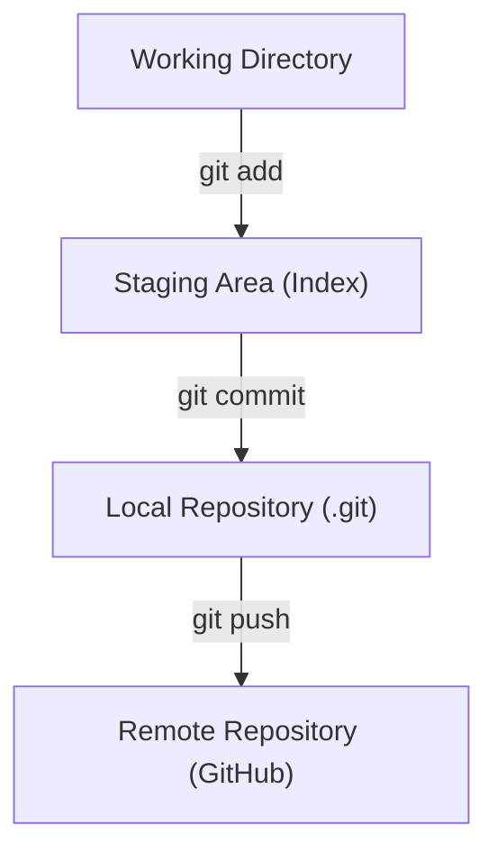

# Day 2 Learning Lab

Welcome to **Day 2** of the Learning Version Control series. This repository contains practice exercises, comprehensive notes, and practical examples for mastering Git and GitHub.

## Table of Contents

1. [Learning Goals](#1-learning-goals)
2. [What Is Git?](#2-what-is-git)
3. [Getting Started](#3-getting-started)
4. [Git Configuration](#4-git-configuration)
5. [Creating and Cloning Repositories](#5-creating-and-cloning-repositories)
6. [Basic Git Workflow](#6-basic-git-workflow)
7. [Checking Repository Status](#7-checking-repository-status)
8. [Staging and Unstaging Changes](#8-staging-and-unstaging-changes)
9. [Committing Changes](#9-committing-changes)
10. [Viewing Commit History](#10-viewing-commit-history)
11. [Comparing Changes](#11-comparing-changes)
12. [Branch Management](#12-branch-management)
13. [Merging Branches](#13-merging-branches)
14. [Handling Merge Conflicts](#14-handling-merge-conflicts)
15. [Working with Remote Repositories](#15-working-with-remote-repositories)
16. [GitHub Workflow](#16-github-workflow)
17. [Undoing and Recovering Changes](#17-undoing-and-recovering-changes)
18. [Stashing Changes](#18-stashing-changes)
19. [Managing Files](#19-managing-files)
20. [Tags and Releases](#20-tags-and-releases)
21. [Searching in Git](#21-searching-in-git)
22. [Git Ignore](#22-git-ignore)
23. [Cleaning Untracked Files](#23-cleaning-untracked-files)
24. [Aliases](#24-aliases)
25. [Advanced Git Commands](#25-advanced-git-commands)
26. [Troubleshooting](#26-troubleshooting)
27. [Git Command Quick Reference](#27-git-command-quick-reference)
28. [Exercises](#28-exercises)
29. [Notes](#29-notes)
30. [License](#30-license)

---

## 1. Learning Goals

* Understand core version control concepts and terminology.
* Learn how Git tracks changes through commits and history.
* Create, clone, and configure repositories.
* Stage, unstage, commit, and compare changes with confidence.
* Master branch creation, switching, renaming, and merging.
* Identify and resolve merge conflicts cleanly.
* Collaborate effectively with remote repositories on GitHub.
* Undo mistakes safely using restore, revert, reset, and reflog.
* Organize projects with `.gitignore`, tags, aliases, and clean-up tools.
* Write clear, professional documentation and follow best Git practices.

---

## 2. What Is Git?

Git is a distributed version control system that tracks changes in files over time.

It helps developers:

* Maintain different versions of a project.
* Collaborate seamlessly with other developers.
* Create separate branches for new features and bug fixes.
* Restore earlier versions of files safely.
* Track who changed a file, what was changed, and when.
* Share code through hosting platforms such as GitHub.

### Important Git Terms

| Term | Description |
| :--- | :--- |
| **Repository** | A project tracked by Git containing history and metadata. |
| **Working directory** | The files and folders you currently see and edit. |
| **Staging area** | The staging index containing changes selected for the next commit. |
| **Commit** | A permanent snapshot of the project recorded in Git history. |
| **Branch** | An independent line of development. |
| **Merge** | The process of combining changes from different branches. |
| **Remote** | A version of the repository hosted elsewhere, such as on GitHub. |
| **Clone** | A local copy of an existing remote repository. |
| **Push** | Upload local commits to a remote repository. |
| **Pull** | Fetch remote changes and integrate them into the current branch. |
| **Fetch** | Download remote updates without modifying local working files. |
| **HEAD** | A pointer to the current commit / branch in your workspace. |
| **Tag** | A named reference commonly used to mark releases (e.g., `v1.0.0`). |
| **Merge conflict** | A situation where Git cannot automatically reconcile competing changes. |

### The Basic Git Workflow



```text
Working Directory
       │
       │ git add
       ▼
Staging Area
       │
       │ git commit
       ▼
Local Repository
       │
       │ git push
       ▼
Remote Repository (GitHub)
```

---

## 3. Getting Started

### Check Whether Git Is Installed

```bash
git --version
```

Display Git’s built-in help:

```bash
git help
```

Get help for a specific command:

```bash
git help commit
git commit --help
git commit -h
```

The -h option generally displays concise help, while --help provides more detailed documentation.

---

## 4. Git Configuration

### Configure Your Identity

Set your global username:

```bash
git config --global user.name "Your Name"
```

Set your global email:

```bash
git config --global user.email "you@example.com"
```

### View Configuration

Display all configuration settings:

```bash
git config --list
```

Display settings with their configuration sources:

```bash
git config --list --show-origin
```

Check a specific setting:

```bash
git config user.name
git config user.email
```

### Configure the Default Branch Name

```bash
git config --global init.defaultBranch main
```

### Set the Default Text Editor

For Visual Studio Code:

```bash
git config --global core.editor "code --wait"
```

### Remove a Configuration Setting

```bash
git config --global --unset user.name
```

> [!NOTE]
> Your Git commit identity is separate from your GitHub login credentials.

---

## 5. Creating and Cloning Repositories

### Create a New Repository

```bash
git init
```

Initialize a repository in a specific directory:

```bash
git init my-project
```

Initialize a repository using main as the initial branch:

```bash
git init -b main
```

### Clone an Existing Repository

```bash
git clone <repository-url>
```

Example:

```bash
git clone https://github.com/username/Day1.git
```

Clone into a directory with a custom name:

```bash
git clone <repository-url> my-folder
```

Clone a specific branch:

```bash
git clone --branch <branch-name> <repository-url>
```

Clone only the latest commit history:

```bash
git clone --depth 1 <repository-url>
```

### Navigate into the Repository

```bash
cd Day1
```

Move to the parent directory:

```bash
cd ..
```

Print the current directory:

```bash
pwd
```

List files:

```bash
ls
```

On Windows Command Prompt, use:

```bash
dir
```

---

## 6. Basic Git Workflow

A typical workflow looks like this:

```bash
git status
git add .
git commit -m "Describe your changes"
git push
```

If the branch has not been connected to a remote branch yet, configure its upstream when pushing:

```bash
git push -u origin main
```

---

## 7. Checking Repository Status

### Check the Current State

```bash
git status
```

Show a compact status:

```bash
git status --short
```

Show the current branch name:

```bash
git branch --show-current
```

Check whether the working directory is clean:

```bash
git status
```

A clean working directory has no pending tracked-file changes or untracked files.

---

## 8. Staging and Unstaging Changes

Staging selects which changes will be included in the next commit.

### Stage a Specific File

```bash
git add README.md
```

### Stage Multiple Files

```bash
git add file1.txt file2.txt
```

### Stage All Changes in the Current Directory

```bash
git add .
```

### Stage All Changes Across the Repository

```bash
git add -A
```

### Stage All Tracked Files

```bash
git add -u
```

### Interactively Stage Changes

```bash
git add -p
```

This lets you choose individual sections of a file to stage.

### Unstage a File

```bash
git restore --staged README.md
```

### Unstage All Staged Changes

```bash
git restore --staged .
```

These commands remove changes from the staging area without discarding the corresponding working-directory edits.

---

## 9. Committing Changes

A commit saves a snapshot of staged changes in the local repository.

### Create a Commit

```bash
git commit -m "Add project documentation"
```

### Commit All Changes to Tracked Files

```bash
git commit -am "Update existing files"
```

This automatically stages modifications and deletions to tracked files, but does not include new, untracked files.

### Open the Editor to Write a Commit Message

```bash
git commit
```

### Amend the Most Recent Commit Message

```bash
git commit --amend -m "Updated commit message"
```

### Add Staged Changes to the Previous Commit

```bash
git add README.md
git commit --amend --no-edit
```

> [!IMPORTANT]
> Amending changes the existing commit. Avoid amending commits that other people have already based work on unless you understand the consequences.

### Create an Empty Commit

```bash
git commit --allow-empty -m "Initial project checkpoint"
```

An empty commit records a commit without file changes.

---

## 10. Viewing Commit History

### View the Full History

```bash
git log
```

### Display One-Line History

```bash
git log --oneline
```

### Display History with a Graph

```bash
git log --oneline --graph --decorate --all
```

### Show the Latest Commit

```bash
git log -1
```

### Show the Last Five Commits

```bash
git log -5 --oneline
```

### Show Commits by Author

```bash
git log --author="Your Name"
```

### Show Commits Since a Date

```bash
git log --since="2026-01-01"
```

### Show Commits Before a Date

```bash
git log --until="2026-10-01"
```

### Show Commits Affecting a Specific File

```bash
git log -- README.md
```

### Show Commit Statistics

```bash
git log --stat
```

### Show the Current Commit Hash

```bash
git rev-parse HEAD
```

### Show Details of a Specific Commit

```bash
git show <commit-hash>
```

### Display the Latest Commit’s Summary

```bash
git show --stat --oneline HEAD
```

---

## 11. Comparing Changes

### Compare Unstaged Changes

```bash
git diff
```

### Compare Staged Changes

```bash
git diff --staged
```

An equivalent option is:

```bash
git diff --cached
```

### Compare Two Commits

```bash
git diff <commit-1> <commit-2>
```

### Compare Two Branches

```bash
git diff main feature-branch
```

### Compare a File Between Branches

```bash
git diff main feature-branch -- README.md
```

### Compare the Current File with the Last Commit

```bash
git diff HEAD -- README.md
```

### Show Only Changed File Names

```bash
git diff --name-only
```

### Show a Summary of Changes

```bash
git diff --stat
```

### Find Who Last Changed Each Line

```bash
git blame README.md
```

Show line-by-line history for a specific range:

```bash
git blame -L 10,25 README.md
```

---

## 12. Branch Management

Branches allow you to work on separate features without directly changing another branch.

### List Local Branches

```bash
git branch
```

### List All Local and Remote-Tracking Branches

```bash
git branch -a
```

### List Remote-Tracking Branches

```bash
git branch -r
```

### Create a Branch

```bash
git branch feature-login
```

### Switch to an Existing Branch

```bash
git switch feature-login
```

### Create and Switch to a New Branch

```bash
git switch -c feature-login
```

### Rename the Current Branch

```bash
git branch -m new-branch-name
```

### Rename a Different Local Branch

```bash
git branch -m old-name new-name
```

### Show Branch Details

```bash
git show-branch
```

### Delete a Merged Local Branch

```bash
git branch -d feature-login
```

### Force-Delete a Local Branch

```bash
git branch -D feature-login
```

> [!WARNING]
> Force-deleting a branch may discard access to commits that are not saved elsewhere.

---

## 13. Merging Branches

Merging combines changes from another branch into the currently checked-out branch.

### Switch to the Target Branch

```bash
git switch main
```

### Merge Another Branch

```bash
git merge feature-login
```

### Merge Without Fast-Forwarding

```bash
git merge --no-ff feature-login
```

This creates a merge commit when the merge succeeds, even when a fast-forward merge would be possible.

### Preview a Merge

```bash
git merge --no-commit --no-ff feature-login
```

This attempts the merge but pauses before creating the merge commit. Review the result before proceeding.

### Abort an Unfinished Merge

```bash
git merge --abort
```

Use this when a merge is in progress and you want to return to the pre-merge state, provided Git can safely restore it.

### Delete the Merged Branch

```bash
git branch -d feature-login
```

---

## 14. Handling Merge Conflicts

A merge conflict occurs when Git cannot automatically reconcile changes made to the same lines in different branches.

### Steps to Resolve a Conflict

1. Run the merge command (`git merge <branch-name>`).
2. Check which files have conflicts (`git status`).
3. Open the conflicted files in your editor.
4. Resolve the conflict markers.
5. Stage the resolved files (`git add <file>`).
6. Complete the merge commit (`git commit`).

### Check Conflicted Files

```bash
git status
```

### Mark a File as Resolved

```bash
git add README.md
```

### Complete the Merge

```bash
git commit
```

### Abort the Merge

```bash
git merge --abort
```

### Example Conflict Markers

```diff
<<<<<<< HEAD
This is the version from the current branch.
=======
This is the version from the incoming branch.
>>>>>>> feature-login
```

Remove the conflict markers (`<<<<<<<`, `=======`, `>>>>>>>`) and keep the desired content before staging the file.

---

## 15. Working with Remote Repositories

A remote repository is a version of your project hosted elsewhere, such as on GitHub.

### List Configured Remotes

```bash
git remote
```

Display remote URLs:

```bash
git remote -v
```

### Add a Remote

```bash
git remote add origin <repository-url>
```

### Change a Remote URL

```bash
git remote set-url origin <repository-url>
```

### Rename a Remote

```bash
git remote rename origin upstream
```

### Remove a Remote

```bash
git remote remove upstream
```

Removing a remote removes the local remote configuration, not the hosted repository.

### Fetch Remote Changes

```bash
git fetch origin
```

Fetch all remotes:

```bash
git fetch --all
```

Fetch and remove stale remote-tracking references:

```bash
git fetch --prune
```

### Pull Changes from a Remote Branch

```bash
git pull origin main
```

### Pull Using Rebase

```bash
git pull --rebase origin main
```

Rebase replays your local commits on top of the updated remote branch instead of creating a merge commit for the integration.

### Push a Branch

```bash
git push origin main
```

### Push and Set the Upstream Branch

```bash
git push -u origin main
```

### Push Later Commits

```bash
git push
```

### Push All Local Branches

```bash
git push --all origin
```

### Delete a Remote Branch

```bash
git push origin --delete feature-login
```

### Display Remote Information

```bash
git remote show origin
```

---

## 16. GitHub Workflow

GitHub hosts Git repositories and provides collaboration features such as pull requests, issues, and code reviews.

### Create a Repository on GitHub

1. Sign in to GitHub.

2. Create a new repository.

3. Copy the repository URL.

4. Connect your local repository to it.

### Connect a Local Repository to GitHub

```bash
git remote add origin <repository-url>
```

Check the remote:

```bash
git remote -v
```

### Push Your First Commit

If the local branch is named main:

```bash
git push -u origin main
```

### Download an Existing GitHub Project

```bash
git clone <repository-url>
```

### Synchronize Your Work

```bash
git add .
git commit -m "Describe your changes"
git pull --rebase origin main
git push
```

Review any conflicts before continuing.

> [!NOTE]
> Git does not itself create GitHub pull requests, issues, or repository settings. Those are GitHub features, accessible through its website or tools such as the GitHub CLI.

### GitHub CLI Commands

If the GitHub CLI (gh) is installed and authenticated, you can use:

```bash
gh auth login
```

Check authentication status:

```bash
gh auth status
```

View repositories:

```bash
gh repo list
```

View repository information:

```bash
gh repo view
```

Create a repository from the current directory:

```bash
gh repo create
```

Create a pull request:

```bash
gh pr create
```

List pull requests:

```bash
gh pr list
```

View issues:

```bash
gh issue list
```

These commands require the GitHub CLI, which is separate from Git.

---

## 17. Undoing and Recovering Changes

Git provides different ways to undo changes. Choose the command according to whether the changes are unstaged, staged, committed, or already shared.

### Discard Unstaged Changes in a File

```bash
git restore README.md
```

This replaces the file’s tracked working-directory contents with the version from the index, normally the staged version or the last staged snapshot.

> [!WARNING]
> Unstaged changes discarded this way may be difficult or impossible to recover.

### Unstage a File but Keep Its Changes

```bash
git restore --staged README.md
```

### Restore a File from a Specific Commit

```bash
git restore --source=<commit-hash> -- README.md
```

### Create a Commit That Reverses an Earlier Commit

```bash
git revert <commit-hash>
```

This is generally the safer way to undo a commit that has already been pushed and shared.

### Undo the Most Recent Commit but Keep Changes Staged

```bash
git reset --soft HEAD~1
```

### Undo the Most Recent Commit but Keep Changes Unstaged

```bash
git reset --mixed HEAD~1
```

--mixed is the default reset mode.

```bash
git reset HEAD~1
```

### Undo the Most Recent Commit and Discard Tracked Changes

```bash
git reset --hard HEAD~1
```

> [!WARNING]
> git reset --hard can permanently discard uncommitted changes and move the current branch backward. Use it carefully.

### Find Earlier Commit References

```bash
git reflog
```

The reflog records recent movements of local references, including many resets and branch switches.

### Recover a Previous Commit

After identifying a suitable commit in the reflog:

```bash
git switch -c recovery-branch <commit-hash>
```

This creates a recovery branch at that commit, preserving a separate reference to it.

---

## 18. Stashing Changes

Stashing temporarily stores local changes so you can work on something else without committing them.

### Save Current Changes

```bash
git stash
```

### Save Changes with a Description

```bash
git stash push -m "Work in progress"
```

### Include Untracked Files

```bash
git stash -u
```

### List Saved Stashes

```bash
git stash list
```

### Inspect a Stash

```bash
git stash show
```

Show its detailed patch:

```bash
git stash show -p
```

### Reapply the Latest Stash and Keep It

```bash
git stash apply
```

### Reapply and Remove the Latest Stash

```bash
git stash pop
```

### Apply a Specific Stash

```bash
git stash apply stash@{1}
```

### Remove a Specific Stash

```bash
git stash drop stash@{1}
```

### Remove All Stashes

```bash
git stash clear
```

> [!WARNING]
> Clearing the stash list can make those changes difficult to recover.

---

## 19. Managing Files

### Rename or Move a Tracked File

```bash
git mv old-name.txt new-name.txt
```

### Remove a File from Git and the Working Directory

```bash
git rm file.txt
```

### Remove a File from Git but Keep It Locally

```bash
git rm --cached file.txt
```

This is useful when you want Git to stop tracking a file while retaining it on your computer.

### Rename a File Manually

You can also rename a file using your file manager or terminal, then stage the changes:

```bash
git add -A
```

Git detects renames by comparing file changes; it does not store renames as a separate fundamental operation in the commit model.

---

## 20. Tags and Releases

Tags mark specific commits, often for software releases.

### Create a Lightweight Tag

```bash
git tag v1.0.0
```

### Create an Annotated Tag

```bash
git tag -a v1.0.0 -m "Version 1.0.0"
```

Annotated tags contain metadata such as the tagger, date, and message.

### List Tags

```bash
git tag
```

### Show Tag Information

```bash
git show v1.0.0
```

### Tag a Specific Commit

```bash
git tag -a v1.0.0 <commit-hash> -m "Version 1.0.0"
```

### Push a Specific Tag

```bash
git push origin v1.0.0
```

### Push All Tags

```bash
git push origin --tags
```

### Delete a Local Tag

```bash
git tag -d v1.0.0
```

### Delete a Remote Tag

```bash
git push origin --delete v1.0.0
```

---

## 21. Searching in Git

### Search for Text in Tracked Files

```bash
git grep "search-term"
```

### Search in a Specific Directory

```bash
git grep "search-term" -- src/
```

### Search Commit Messages

```bash
git log --grep="bug fix"
```

### Find Commits That Changed a Particular Text

```bash
git log -S"search-term" --oneline
```

### Find Commits That Changed a Regular Expression Match

```bash
git log -G"pattern" --oneline
```

### Show Files Changed in a Commit

```bash
git show --name-only <commit-hash>
```

---

## 22. Git Ignore

A `.gitignore` file specifies untracked files and directories that Git should intentionally ignore.

### Create a .gitignore File

```bash
touch .gitignore
```

On Windows Command Prompt:
```cmd
type nul > .gitignore
```

### Example .gitignore

```gitignore
# Python
__pycache__/
*.pyc
.venv/

# Node.js
node_modules/

# Environment variables
.env

# Build output
dist/
build/

# Operating system files
.DS_Store
Thumbs.db

# IDE settings
.vscode/
```

Add patterns appropriate to your project.

### Check Whether a File Is Ignored

```bash
git check-ignore -v filename
```

> [!IMPORTANT]
> **Already-Tracked Files**: Adding a file to `.gitignore` does not automatically stop tracking it if it has already been committed in Git history.

To stop tracking it while keeping the local copy:

```bash
git rm --cached filename
git commit -m "Stop tracking generated file"
```

For an entire directory, such as `node_modules/`:

```bash
git rm -r --cached node_modules/
git commit -m "Stop tracking dependencies"
```

Only do this when you intentionally want to remove those paths from version control.

---

## 23. Cleaning Untracked Files

### Preview Files That Would Be Removed

```bash
git clean -n
```

### Preview Untracked Files and Directories

```bash
git clean -nd
```

### Remove Untracked Files

```bash
git clean -f
```

### Remove Untracked Files and Directories

```bash
git clean -fd
```

### Include Ignored Files in the Preview

```bash
git clean -ndx
```

### Remove Untracked and Ignored Files

```bash
git clean -fdx
```

> [!WARNING]
> These commands can permanently delete untracked files and directories. Always preview the affected files before running a destructive cleanup command.

---

## 24. Aliases

Git aliases let you create shortcuts for frequently used commands.

### Create a Status Shortcut

```bash
git config --global alias.st status
```

Usage:

```bash
git st
```

### Create a Short Log Shortcut

```bash
git config --global alias.lg "log --oneline --graph --decorate --all"
```

Usage:

```bash
git lg
```

### Create a Branch Listing Shortcut

```bash
git config --global alias.br branch
```

Usage:

```bash
git br
```

### List Your Aliases

```bash
git config --get-regexp '^alias\.'
```

### Remove an Alias

```bash
git config --global --unset alias.st
```

---

## 25. Advanced Git Commands

These commands are useful when you become more comfortable with Git.

### Cherry-Pick a Commit

Apply the changes from a particular commit to the current branch:

```bash
git cherry-pick <commit-hash>
```

Abort an in-progress cherry-pick:

```bash
git cherry-pick --abort
```

### Rebase a Branch

Reapply the current branch’s commits on top of another branch:

```bash
git rebase main
```

Continue after resolving a rebase conflict:

```bash
git rebase --continue
```

Abort the rebase:

```bash
git rebase --abort
```

> [!WARNING]
> Rebasing rewrites commit history. Avoid rebasing shared commits unless your team has agreed to that workflow.

### Interactive Rebase

Review and potentially edit recent commits:

```bash
git rebase -i HEAD~3
```

This opens an editor where you can reorder, combine, reword, or otherwise modify the selected commits.

### Create a Patch

Generate a patch for a commit:

```bash
git format-patch -1 <commit-hash>
```

### Apply a Patch

```bash
git apply patch-file.patch
```

### Check a Patch Before Applying It

```bash
git apply --check patch-file.patch
```

### Apply a Patch as a Commit

```bash
git am patch-file.patch
```

### Show Repository Information

```bash
git rev-parse --show-toplevel
```

Display the Git directory:

```bash
git rev-parse --git-dir
```

Display the current branch and commit:

```bash
git log -1 --oneline --decorate
```

### List Files Tracked by Git

```bash
git ls-files
```

### Check Repository Object Integrity

```bash
git fsck
```

This command checks the repository’s object database for certain integrity problems.

### Optimize the Local Repository

```bash
git gc
```

Git may perform repository maintenance automatically, so manual execution is not usually necessary.

---

## 26. Troubleshooting

### Problem: Git Says You Are Not in a Repository

Check the current directory:

```bash
pwd
```

Move into your project:

```bash
cd Day1
```

Initialize a repository only if you intend to create a new one:

```bash
git init
```

### Problem: Git Says There Is Nothing to Commit

Check your status:

```bash
git status
```

Review the changed files and stage the intended changes:

```bash
git add README.md
```

Then commit:

```bash
git commit -m "Update README"
```

### Problem: The Remote Is Missing

```bash
git remote -v
```

If the repository has no remote and you want to connect it to GitHub:

```bash
git remote add origin <repository-url>
```

### Problem: Push Is Rejected Because the Remote Has New Commits

Inspect the repository status and fetch remote changes:

```bash
git fetch origin
```

Integrate the appropriate remote branch:

```bash
git pull --rebase origin main
```

Resolve any conflicts, then push:

```bash
git push
```

> [!WARNING]
> Do not use force-push as the first solution to a rejected push.

### Problem: The Current Branch Has No Upstream

Set its upstream:

```bash
git push -u origin <branch-name>
```

### Problem: You Forgot Which Branch You Are On

```bash
git branch --show-current
```

### Problem: You Want to See What Changed Before Committing

```bash
git status
git diff
git diff --staged
```

### Problem: You Accidentally Changed the Wrong File

Inspect the changes:

```bash
git diff -- filename
```

If you want to discard the unstaged changes in that file:

```bash
git restore filename
```

> [!WARNING]
> This discards the file’s unstaged changes.

---

## 27. Git Command Quick Reference

| Task | Command |
| :--- | :--- |
| Check Git version | `git --version` |
| Initialize repository | `git init` |
| Clone repository | `git clone <url>` |
| Check status | `git status` |
| Show short status | `git status --short` |
| Stage a file | `git add <file>` |
| Stage all changes | `git add -A` |
| Unstage a file | `git restore --staged <file>` |
| Commit changes | `git commit -m "message"` |
| Amend last commit | `git commit --amend` |
| View commit history | `git log` |
| View compact history | `git log --oneline` |
| Show commit details | `git show <commit>` |
| Compare unstaged changes | `git diff` |
| Compare staged changes | `git diff --staged` |
| List branches | `git branch` |
| Create a branch | `git branch <name>` |
| Switch branches | `git switch <name>` |
| Create and switch branches | `git switch -c <name>` |
| Merge a branch | `git merge <name>` |
| Delete a local branch | `git branch -d <name>` |
| List remotes | `git remote -v` |
| Fetch remote updates | `git fetch origin` |
| Pull remote updates | `git pull origin main` |
| Push changes | `git push` |
| Push and set upstream | `git push -u origin main` |
| Temporarily save changes | `git stash` |
| List stashes | `git stash list` |
| Reapply a stash | `git stash apply` |
| Undo a commit safely | `git revert <commit>` |
| Reset while keeping staged changes | `git reset --soft <commit>` |
| Reset while keeping unstaged changes | `git reset --mixed <commit>` |
| Reset and discard tracked changes | `git reset --hard <commit>` |
| Recover reference history | `git reflog` |
| Rename a tracked file | `git mv <old> <new>` |
| Remove a tracked file | `git rm <file>` |
| List tags | `git tag` |
| Create an annotated tag | `git tag -a <tag> -m "message"` |
| Search tracked files | `git grep "text"` |
| Find who changed each line | `git blame <file>` |
| List tracked files | `git ls-files` |
| Preview untracked cleanup | `git clean -n` |
| Get help | `git help <command>` |

---

## 28. Exercises

Complete these exercises to practise the commands covered in this lesson.

### Exercise 1: Repository Setup

1. Create a folder named Day1.
2. Navigate into it.
3. Initialize a Git repository.
4. Check the Git version.
5. Configure your Git username and email.
6. Check the repository status.
### Exercise 2: File Tracking

1. Create a README.md file.
2. Add a short description.
3. Check the repository status.
4. Stage the file.
5. Inspect the staged changes.
6. Commit the file.
### Exercise 3: Working with Changes

1. Modify README.md.
2. View the unstaged changes.
3. Stage the file.
4. View the staged changes.
5. Commit the changes with a descriptive message.
6. Review the commit history.
### Exercise 4: Branching

1. Create a branch named feature-notes.
2. Switch to the branch.
3. Create a file named notes.txt.
4. Commit the new file.
5. Switch back to main.
6. Merge feature-notes.
7. Inspect the commit history.
8. Delete the merged feature branch.
### Exercise 5: Remote Repository

1. Create a repository on GitHub.
2. Connect your local repository to it.
3. Push the main branch.
4. Verify the remote URL.
5. Clone the repository into another directory.
6. Make a change in the cloned repository.
7. Commit and push the change.
### Exercise 6: Undoing Changes

1. Modify a tracked file.
2. Inspect the change.
3. Stage the file.
4. Unstage the file without losing the modification.
5. Save the change in a commit.
6. Create a second commit.
7. Use git revert to undo the second commit.
8. Inspect the resulting history.
### Exercise 7: Stashing

1. Modify a tracked file without committing.
2. Save the changes using git stash.
3. Check the stash list.
4. Restore the saved changes.
5. Inspect the working directory.
### Exercise 8: Tags

1. Create an annotated tag named v1.0.0.
2. Display the tag.
3. Push the tag to GitHub.
4. Verify that the tag exists in the remote repository.
### Exercise 9: Documentation

1. Add a .gitignore file.
2. Include appropriate patterns for your project.
3. Update the README with project information.
4. Stage and commit the changes.
5. Push the changes to GitHub.

---

## 29. Notes

Use this section to record questions, key takeaways, and useful links discovered during the lesson.
### Key Takeaways

* Git tracks changes to files over time.
* git add stages changes.
* git commit saves staged changes in local history.
* git branch helps organize independent lines of development.
* git merge combines branch changes.
* git fetch downloads remote updates without integrating them.
* git pull downloads and integrates remote changes.
* git push uploads local commits.
* git revert creates a new commit that reverses an earlier commit.
* git reset moves a branch reference and can change the state of the staging area and working directory.
* git stash temporarily saves local changes.
* .gitignore helps prevent unwanted untracked files from being added to Git.
### Important Safety Reminders

1. Review git status before running commands that change your repository.
2. Review git diff before staging or discarding changes.
3. Avoid git reset --hard unless you are certain you want to discard the affected changes.
4. Avoid git clean -fd and git clean -fdx unless you have checked which files will be deleted.
5. Avoid force-pushing to shared branches without understanding the impact on collaborators.
6. Never commit passwords, access tokens, API keys, or other secrets.
7. Remember that deleting a file from the latest commit does not necessarily remove it from earlier commits in the repository history.

---

## 30. License

This learning project is provided for educational purposes.
